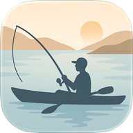
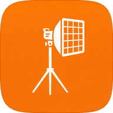
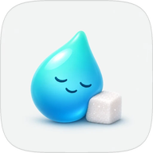

# Yusuf Karan

**iOS Engineer** · Swift & SwiftUI

Building indie apps at **[KaranLabs](https://karanlabs.com)**. Previously at Tera Yatırım Bankası, on its mobile banking app.

[Website](https://karanlabs.com) · [LinkedIn](https://linkedin.com/in/yusuf-karan) · [X](https://twitter.com/yusufkaranx) · [Medium](https://medium.com/@yusufkaran) · [YouTube](https://youtube.com/@yusufkaran) · [Email](mailto:contact@karanlabs.com)

<table>
  <tr>
    <td align="center" width="33%">
      <a href="https://apps.apple.com/us/app/whatsrapped-chat-summary/id6767378532"> <b>Whatsrapped</b></a> 
      Your WhatsApp chat as a year in review
    </td>
    <td align="center" width="33%">
      <a href="https://apps.apple.com/app/id6830352187"> <b>KRN IPTV</b></a> 
      IPTV player for iPhone, Mac &amp; Apple TV
    </td>
    <td align="center" width="33%">
      <a href="https://apps.apple.com/tr/app/gownai-wedding-dress-try-on/id6760121171"> <b>GownAI</b></a> 
      AI try-on for bridal and evening wear
    </td>
  </tr>
  <tr>
    <td align="center" width="33%">
      <a href="https://apps.apple.com/tr/app/reyyan-namaz-zikir-rehber/id6758559930?l=tr"> <b>Reyyan</b></a> 
      Prayer times, Quran, Qibla and dhikr
    </td>
    <td align="center" width="33%">
      <a href="https://apps.apple.com/us/app/detox-ai/id6743253433"> <b>DetoxAI</b></a> 
      Detox water recipes made for you
    </td>
    <td align="center" width="33%">
      <a href="https://apps.apple.com/us/app/fish-trackr/id6752625875"> <b>Fish Trackr</b></a> 
      A private fishing diary with GPS spots
    </td>
  </tr>
  <tr>
    <td align="center" width="33%">
      <a href="https://apps.apple.com/us/app/portable-softbox-pro/id6468909833"> <b>Portable Softbox Pro</b></a> 
      Turns an iPhone into a studio light
    </td>
    <td align="center" width="33%">
      <a href="https://karanlabs.com/glunote/"> <b>Glunote</b></a> 
      Blood sugar logbook · coming soon
    </td>
    <td align="center" width="33%">
      <a href="https://karanlabs.com/uavforecast/"> <b>UAV Forecast</b></a> 
      Drone weather · coming soon
    </td>
  </tr>
</table>

